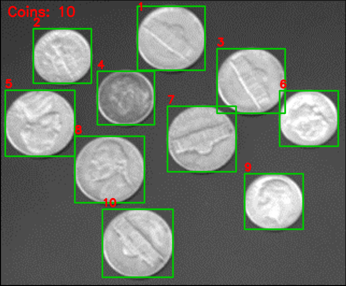

# CoinCounter

使用 C++ 和 OpenCV 对硬币图片进行二值化并统计硬币数量。

示例图片的识别结果为 **10 枚硬币**。



## 算法流程

1. 彩色图片转换为灰度图。
2. 使用 5×5 高斯滤波平滑图像，降低噪声。
3. 使用大津法（Otsu）二值化，把明亮的硬币变成白色前景。
4. 清除图片四周的白色边框，避免边框被当成硬币。
5. 使用 5×5 椭圆结构元执行闭运算，填补硬币内部的小孔。
6. 使用 `findContours` 提取外轮廓。
7. 过滤面积小于 1000 像素的噪声轮廓。
8. 对保留的硬币画外接矩形、编号并统计数量。

## 在 VS Code 中运行

1. 使用 VS Code 打开本文件夹。
2. 按 `F5`。
3. 程序编译运行后显示二值图、清理结果和最终计数。
4. 按任意键关闭图片窗口。

输出文件：

- `output/01_binary.png`：Otsu 二值图。
- `output/02_cleaned.png`：清除边框并闭运算后的图。
- `output/03_result.png`：编号和计数结果。

## 换用其他图片

默认读取 `coins.png`。也可以传入图片路径：

```powershell
.\build\Debug\CoinCounter.exe "D:\images\coins.png"
```

若换图后计数不准，可以调整 `main.cpp` 中的 `kBorder` 和 `kMinArea`。
该程序假设硬币比背景亮，且硬币之间没有重叠。
