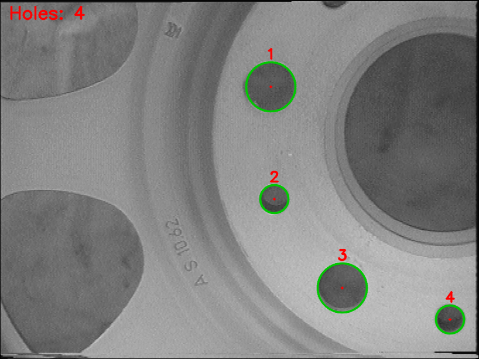

# HoleCounter

使用 C++ 和 OpenCV 识别图片中完整的圆形孔。

示例图片的识别结果为 **4 个孔**。



## 算法流程

1. 读取彩色图片并转换为灰度图。
2. 使用 7×7 高斯滤波平滑，抑制噪声。
3. 使用 Canny 提取边缘（Hough 检测内部也会用到边缘信息）。
4. 使用霍夫圆变换 `HoughCircles`（`HOUGH_GRADIENT`）检测圆形孔。
5. 按从上到下、从左到右排序。
6. 画出每个孔的圆形轮廓、圆心和编号，并统计数量。

## 为什么用霍夫圆变换

这些孔是标准的圆形，边缘清晰，霍夫圆变换对它们非常稳定：
`param2`（累加器阈值）在 15~30 之间都能得到同样的 4 个圆。
相比“二值化 + 轮廓 + 圆度筛选”，霍夫圆不需要把整幅图二值化，
因此不会被左下方大块阴影、右侧大孔洞等暗区干扰。

## 在 VS Code 中运行

1. 使用 VS Code 打开本文件夹。
2. 按 `F5`。
3. 程序编译运行后显示灰度图、边缘图和最终识别结果。
4. 按任意键关闭图片窗口。

输出文件：

- `output/01_gray.png`：灰度图。
- `output/02_edges.png`：Canny 边缘图。
- `output/03_result.png`：编号和计数结果。

## 换用其他图片

默认读取 `holes.png`。也可以传入图片路径：

```powershell
.\build\Debug\HoleCounter.exe "D:\images\holes.png"
```

若换图后检测不准，可以调整 `main.cpp` 中的：

- `kMinRadius` / `kMaxRadius`：孔的半径范围。
- `kAccumThresh`：累加器阈值，越大越严格、越少误检。
- `kMinDist`：两个圆心之间的最小距离，避免同一孔被重复检测。
