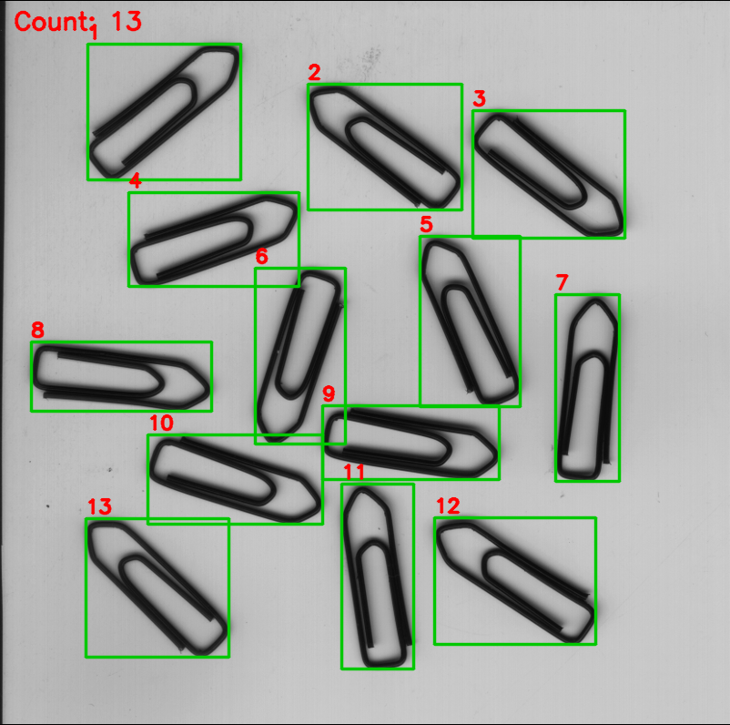

# PaperclipCounter

使用 C++ 和 OpenCV 识别并统计图片中的回形针数量。

示例图片的识别结果为 **13 个**。



## 算法流程

1. 读取彩色图片并转换为灰度图。
2. 使用大津法（Otsu）反向二值化，使暗色回形针成为白色前景。
3. 清除图片四周的黑框，避免黑框被识别成一个目标。
4. 使用 7×7 椭圆结构元执行闭运算，连接同一回形针内部的小断裂。
5. 使用 `findContours` 提取外轮廓。
6. 过滤面积小于 500 像素的噪声轮廓。
7. 对有效轮廓画外接矩形、编号并统计数量。

闭运算等于“先膨胀、后腐蚀”。膨胀负责连接断裂，腐蚀负责把目标缩回，
比单独膨胀更不容易把相邻回形针粘在一起。本例即使不做形态学处理也可以
得到正确结果，闭运算主要用于提高稳定性。

## 在 VS Code 中运行

1. 使用 VS Code 打开本文件夹。
2. 按 `F5`。
3. 程序编译运行后会显示二值图、闭运算结果和最终识别结果。
4. 按任意键关闭图片窗口。

输出文件：

- `output/01_binary.png`：Otsu 二值图。
- `output/02_closed.png`：闭运算结果。
- `output/03_result.png`：编号和计数结果。

## 换用其他图片

默认读取 `paperclips.png`。也可以传入图片路径：

```powershell
.\build\Debug\PaperclipCounter.exe "D:\images\paperclips.png"
```

若换图后计数不准，可以调整 `main.cpp` 中的：

- `kBorder`：清除图片边缘的像素宽度。
- `kKernelSize`：形态学结构元大小。
- `kMinArea`：最小有效轮廓面积。

该方法假设回形针与背景有明显亮度差异，且回形针之间没有严重重叠。
